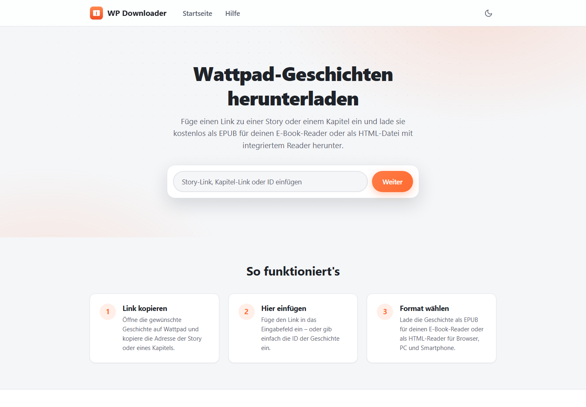
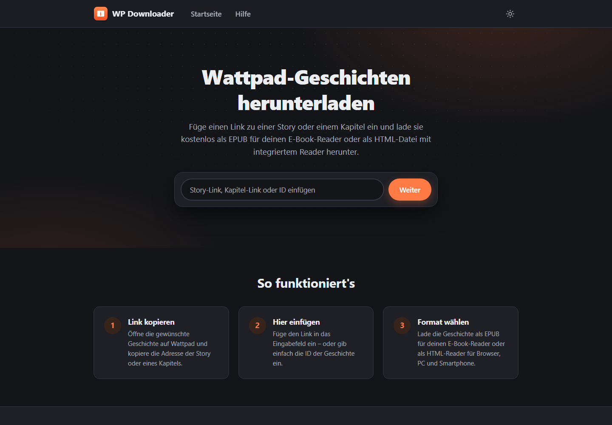
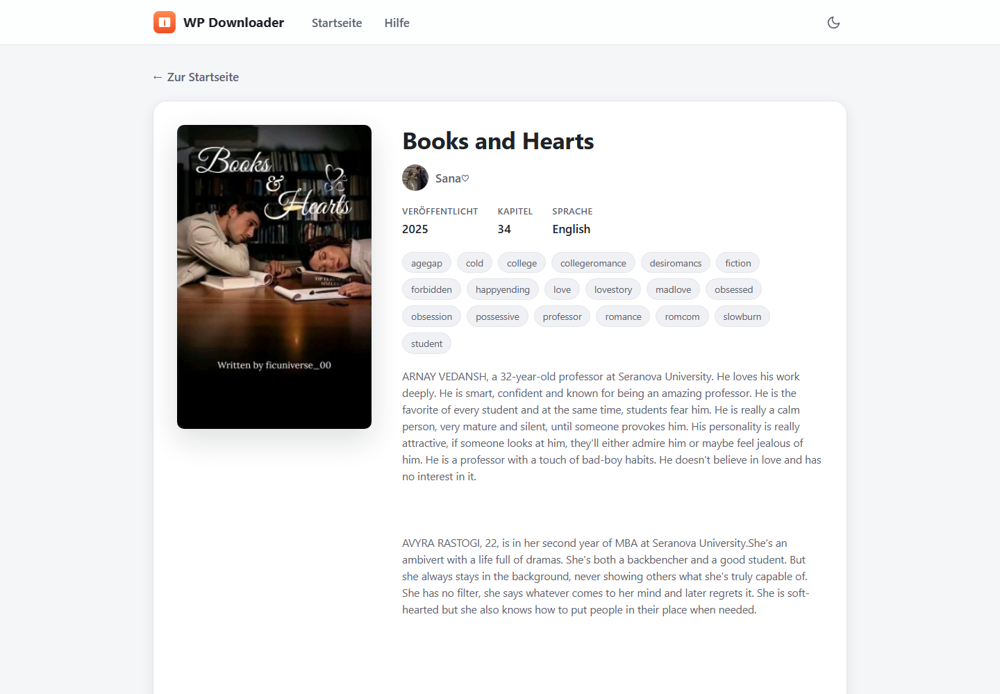

# WP Downloader

> [!NOTE]
> **WP Downloader** ist ein unabhängiges Open-Source-Projekt und steht in keiner Verbindung zu **Wattpad Corp.**

Lade Wattpad-Geschichten kostenlos herunter – als **EPUB** für deinen E-Book-Reader oder als **HTML-Datei mit integriertem Reader** für Browser, PC und Smartphone. Die HTML-Datei funktioniert komplett offline und bietet anpassbare Schriftart, Schriftgröße und Farbmodus (Hell, Sepia, Dunkel).

- **Framework:** [Node.js](https://nodejs.org/) ≥ 18 + [Express 5](https://expressjs.com/)
- **Templates:** [Pug](https://pugjs.org/)
- **Formate:** EPUB 2 und eigenständiger HTML-Reader

## Screenshots

| Startseite (hell) | Startseite (dunkel) | Buchseite |
| --- | --- | --- |
|  |  |  |

## Installation

> [!IMPORTANT]
> Dies ist eine **Server-Software**, keine klassische App. Sie wird auf einem Server (oder lokal auf dem eigenen Rechner) gestartet und im Browser aufgerufen. Für den Betrieb wird [Node.js](https://nodejs.org/) ≥ 18 benötigt.

```bash
# 1. Repository klonen
git clone https://github.com/MaximilianGT500/wp-downloader.git
cd wp-downloader

# 2. Abhängigkeiten installieren
npm install

# 3. Starten
npm start
# → http://localhost:3000
```

Für die Entwicklung mit automatischem Neustart:

```bash
npm run dev
```

## Konfiguration (Umgebungsvariablen)

| Variable | Standard | Beschreibung |
| --- | --- | --- |
| `PORT` | `3000` | Port, auf dem der Server lauscht |
| `HOST` | `0.0.0.0` | Bind-Adresse des Servers |
| `DEFAULT_LANG` | `de` | Fallback-Sprache, wenn keine passende Browser-Sprache gefunden wird |
| `CACHE_TTL` | `86400` | Cache-Lebensdauer (Sekunden) für API-Antworten und Kapiteltexte |
| `REQUEST_TIMEOUT` | `15000` | Timeout (ms) für Anfragen an die Wattpad-API |
| `PART_CONCURRENCY` | `5` | Anzahl parallel geladener Kapitel |
| `PART_RETRIES` | `2` | Wiederholungsversuche pro Kapitel |
| `NODE_ENV` | – | `production` aktiviert das View-Caching |

## Verwendung

1. Öffne die gewünschte Geschichte auf Wattpad.
2. Kopiere die URL der Story **oder** eines Kapitels.
3. Füge sie auf der Startseite in das Eingabefeld ein – oder gib direkt die Story-ID ein.
4. Wähle auf der Buchseite das gewünschte Format:
   - **EPUB** – für E-Book-Reader (Tolino, Kindle, Apple Books, …)
   - **HTML** – eine einzelne Datei mit integriertem Reader, öffnet sich in jedem Browser

Alternativ lässt sich die Wattpad-URL auch direkt umschreiben: `https://www.wattpad.com/story/<id>-<slug>` → `http://localhost:3000/story/<id>-<slug>` (die Weiterleitung funktioniert automatisch).

## API

> [!WARNING]
> Die Endpunkte sind **nicht für automatisierte Massenabfragen** gedacht – der Server lädt bei jedem Download sämtliche Kapitel von Wattpad.

### `GET /api/health`

Statusprüfung. Antwort: `{ "status": "ok", "uptime": <sekunden> }`

### `GET /api/:id/download/:format`

| Parameter | Beschreibung |
| --- | --- |
| `id` | ID der Wattpad-Story |
| `format` | `epub` \| `html` |

Antworten:

- `200` – Datei-Download (`Content-Disposition: attachment`)
- `400` – `{ "error": "unknown_format" }` oder `{ "error": "invalid_id" }`
- `404` – `{ "error": "book_not_found" }`
- `502` – `{ "error": "parts_unavailable" }` (keine Kapitel ladbar)
- `500` – `{ "error": "internal_server_error" }`

## Formate

### EPUB
Das offene E-Book-Format (`.epub`), unterstützt von praktisch allen Readern und kompatibler Software auf Smartphones, Tablets und PCs.

### HTML
Eine einzelne `.html`-Datei mit komplettem Reader inklusive der Geschichte – offline nutzbar, mit veränderbarer Schriftart, Schriftgröße und Farbmodus.

## Projektstruktur

- `/lang` – JSON-Dateien mit den Übersetzungen (Dateiname = Sprachkürzel aus dem `Accept-Language`-Header)
- `/routes` – Express-Router (Frontend + API)
- `/services` – statische Service-Klassen (Wattpad-API, Konvertierung, Übersetzung, Logger)
- `/static` – statische Assets (CSS, Client-JS, Icons, Manifest)
- `/templates` – Vorlagen für die Konvertierung (EPUB-Struktur, HTML-Reader)
- `/tools` – Hilfsskripte (z. B. Icon-Generierung)
- `/views` – Pug-Templates der Website
- `/docs/screenshots` – Screenshots für das README

## Rechtliches & Bedingungen

Dieser Service ist **ausschließlich für den privaten Gebrauch** gedacht. Es ist nicht erlaubt, heruntergeladene E-Books anderer zu verkaufen – wir unterstützen oder tolerieren solche Aktivitäten nicht. Bitte respektiere die Rechte der Autorinnen und Autoren.

## Danksagung

Vielen Dank an [Feuerhamster](https://github.com/Feuerhamster) und [BluemediaGER](https://github.com/BluemediaGER) für den ursprünglichen Quellcode.

## Lizenz

[MIT](LICENSE) © MaximilianGT500
